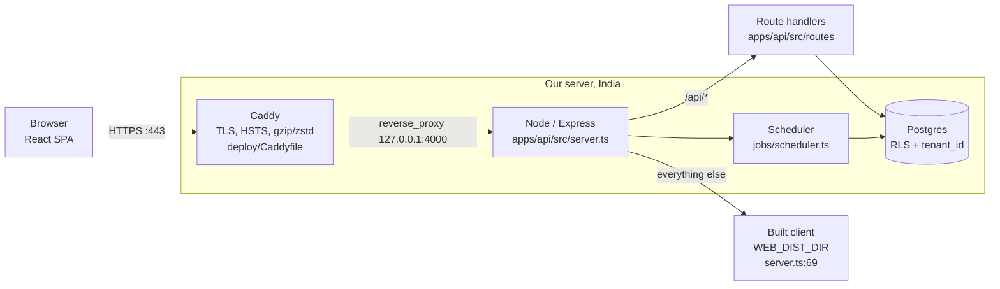
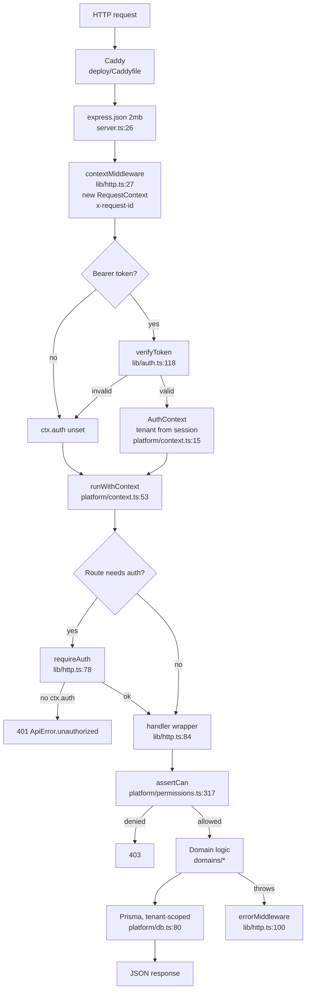
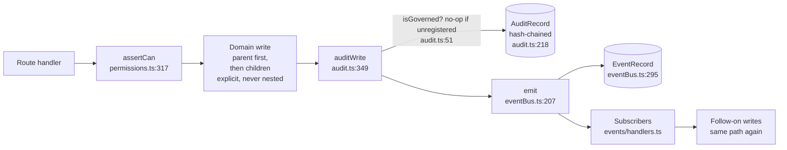
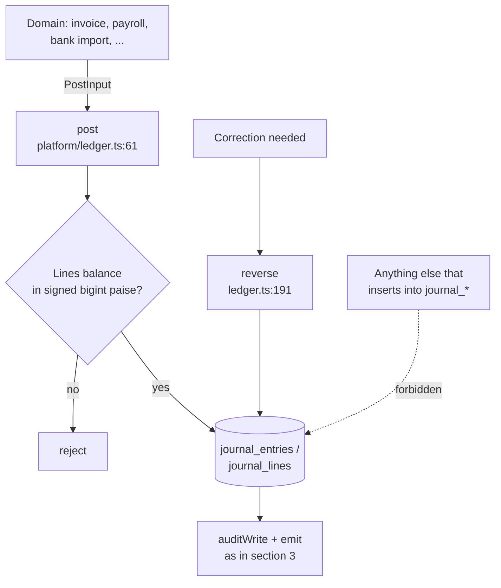
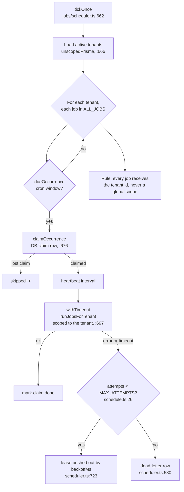
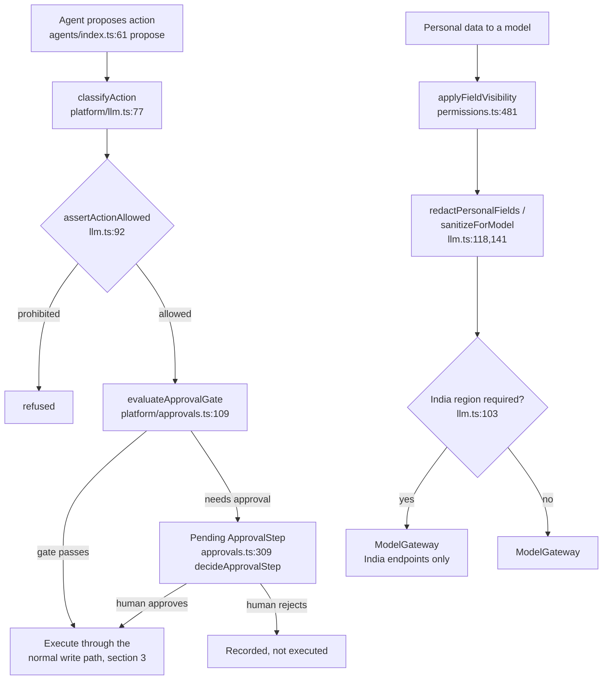
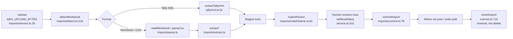

# System design: flows and topology

This page is the picture. The reasoning behind the rules (tenancy as a gate, identity resolving once, the event fabric's ordering) is in [architecture.md](architecture.md). Every node below names the file that implements it, so the diagrams can be checked against the code with `Read offset/limit` on the line given. Line numbers are as of this writing; `docs/plan/MAP.md` is the index that stays current.

## 1. Deployment topology

One server in India runs everything. No request leaves for a third-party edge. The Cloudflare Worker that once sat in front of the client has been removed.

Facts this rests on:

- Caddy terminates TLS and proxies everything to Node. `deploy/Caddyfile` sets `reverse_proxy 127.0.0.1:{$API_PORT:4000}`.
- Express trusts `X-Forwarded-For` only from a loopback peer (`server.ts:24`, `trust proxy` = `loopback`). A client that reaches Node without going through Caddy cannot spoof its IP, but the port still has to be firewalled.
- The API serves `/api` and the client from one origin, so there is no CORS between them (`server.ts:44`, `:69`).
- In development, Vite proxies `/api` to `localhost:4000` (`apps/web/vite.config.ts:46`).

## 2. Request lifecycle

Every HTTP request runs through the same three steps before a handler sees it: a request context, an identity, and then the route's own checks.

The tenant is never read from a body, query string or JWT claim. It comes from the resolved session (`CLAUDE.md`, rule 6). Prisma's extension injects it and Postgres RLS enforces it underneath.

## 3. The write path

Every write follows the same order. The order matters: the audit record is written before the event is emitted, so a subscriber never sees a change that has no audit trail.

Two checks keep this honest:

- `auditWrite` silently does nothing for an entity that is not registered with `registerGovernedEntities` (`audit.ts:39`, `isGoverned` at `:51`). The check is on the registration list, not on the verb list `AUDIT_ACTIONS` (`:19`). Registering a new entity is part of adding it.
- Events are validated against the `kz.<domain>.<object>.<verb>` grammar when emitted and again when stored (`CLAUDE.md`, rule 5).

## 4. Ledger posting

Only `platform/ledger.ts` writes to the journal. Posted entries are immutable: the application database role has no `UPDATE` or `DELETE`. A correction is a reversal, not an edit.

Money is signed `bigint` in paise throughout. There is no `number`, `float` or `Decimal` in application code. The money helper (`packages/shared/src/money.ts`, item 1.6) is not yet written, so `packages/shared/src/finance.ts` still uses `number` and is a known defect, not a pattern to copy.

## 5. Background jobs

The scheduler is a per-tenant loop. It checks which jobs are due, claims each occurrence in the database so two instances cannot both run it, and runs it under a timeout with a heartbeat.

Every job is tenant-scoped. A background job that forgets the tenant is among the most common ways a multi-tenant system leaks data (`CLAUDE.md`, rule 6). Nested Prisma writes also bypass the tenant extension, so jobs write the parent and then each child explicitly.

## 6. Agent proposals and approval gates

Agents never act directly. They propose an action, and a policy decides whether a human must approve it first. The hard prohibitions (no journal posting, no IRN generation, no return filing, no payroll run, no customer email without a human) are in `packages/shared/src/ai.ts`, not in configuration.

The personal-data branch is a cross-border control under DPDP. Data that leaves for a model without `applyFieldVisibility` is a violation even when the model is one we trust.

## 7. Import pipeline

Imports are staged first and committed later, so a human can see every row, decide on the matches, and revert the whole batch.

`commit.ts:721` currently hard-deletes on revert. That path is a known defect. It should become a reversal through `post()`, and it is a bug to fix, not a precedent to follow (`CLAUDE.md`, "Never").

## 8. Where to look next

| Question | Start here |
|---|---|
| Why the system is shaped this way | [architecture.md](architecture.md) |
| Which file or symbol does X | `docs/plan/MAP.md`, or `/where <thing>` |
| Current work and what is next | `docs/plan/CURRENT.md`, `docs/plan/zen360/ORDERED-PLAN.md` |
| Money rules | `CLAUDE.md` rule 1; `docs/plan/archive/phase-1-ledger.md` |
| Statutory parameters | `CLAUDE.md` rule 4; `StatutoryRule` in `apps/api/prisma/schema` |
| Schema changes | `apps/api/prisma/migrations`, gated by `pnpm --filter @kaizen/api db:drift` |
